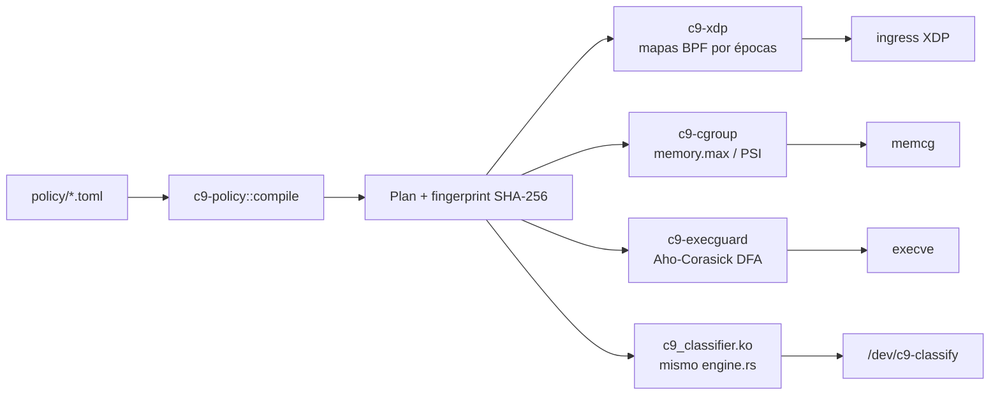

# cortex9-framework

[](https://github.com/federiconbaez/cortex9-framework/actions/workflows/ci.yml)
[](LICENSE)

> **ES** primero · **EN** below

Un solo repositorio, una sola política, cuatro puntos de enforcement en el
kernel. La tesis no se afirma: se mide.

---

## ES

### Hipótesis

| # | Hipótesis | Qué se mide | Qué no |
|---|---|---|---|
| 1 | Rust en el kernel reduce clases de vulnerabilidad de memoria frente a C equivalente | Matriz CWE (compile_time / runtime_check / not_prevented) + acuerdo diferencial userspace↔módulo en QEMU | Rendimiento del path de red en producción; drivers reales fuera del clasificador |
| 2 | XDP puede ser un firewall dinámico sin recargar el programa ni pagar un cambio de contexto a userspace por paquete | Tasa de drop vs nftables en veth, pps del sender, latencia media de hot-reload | XDP nativo en NIC real (solo SKB en veth); proxy L7 |
| 3 | cgroups v2 con `memory.max` + `oom.group` contiene una carga tipo inferencia sin OOM del host | OOM dentro del cgroup, canario vivo afuera, delta de `oom_kill` del host | Aislamiento de GPU/VRAM (sin GPU en las máquinas de prueba; ver `docs/gpu.md`) |
| 4 | fanotify + Aho-Corasick bloquea binarios no confiables en milisegundos | p50/p99 de decisión, e2e deny/allow, 0 falsos positivos en corpus benigno | Cobertura de firmas del mundo real; el backend seccomp tiene una carrera por ruta |

### La pieza ingeniosa: una política, tres enforcers



`c9-policy` compila un TOML estricto a un `Plan` canónico. Reordenar reglas,
poner bits de host en un CIDR o duplicar puertos no cambia la huella. Una
contradicción entre pilares (p. ej. un workload que expone un puerto que el
firewall deniega) se rechaza **antes** de tocar el kernel (`C9E002`).

### Arquitectura

| Crate / path | Rol |
|---|---|
| `crates/c9-classify` | Motor IPv4 `no_std`, sin alloc, sin `unsafe`. Mismo `engine.rs` en userspace, Miri y el módulo del kernel |
| `crates/c9-policy` | Compilador TOML → Plan + diagnósticos |
| `crates/c9-xdp` + `bpf/xdp_fw.bpf.c` | Firewall XDP; reglas en doble buffer (2 épocas + selector de 1 palabra) |
| `crates/c9-cgroup` | Supervisor cgroup v2 + `c9-hog` |
| `crates/c9-execguard` | fanotify `FAN_OPEN_EXEC_PERM` y seccomp `USER_NOTIF` |
| `crates/cortex9` | CLI: `policy`, `xdp`, `cgroup`, `exec`, `classify` |
| `kernel/` | Módulo Rust-for-Linux + scripts QEMU |
| `cwe/` | Matriz CWE medible |
| `benches/` | Mediciones reproducibles (root) |

### Resultados medidos

Ver [`results/SUMMARY.md (CI run [40808440418](https://github.com/federiconbaez/cortex9-framework/actions/runs/40808440418))`](results/SUMMARY.md (CI run [40808440418](https://github.com/federiconbaez/cortex9-framework/actions/runs/40808440418))) y los JSON de ese directorio.
Resumen de una corrida local (reproducir con los comandos de abajo):

| Pilar | Resultado |
|---|---|
| 1 | 20000/20000 acuerdos en QEMU (kernel 7.2.13); CWE 9 compile_time + 4 runtime_check + 2 not_prevented de 15 |
| 2 | drop rate XDP = 1.0 (= nftables) sobre 50000 frames; reload avg 1577 µs (CI) |
| 3 | OOM dentro del cgroup, canario vivo, host `oom_kill` delta = kills del memcg |
| 4 | fanotify p99 decisión 0.121 ms (CI); 0 falsos positivos |

### Reproducir

```bash
# userspace
cargo test --workspace --features c9-classify/std
python3 cwe/run.py results/cwe.json

# root — cada job falla en voz alta si no puede ejecutarse
sudo cargo test -p c9-xdp --features privileged-tests -- --test-threads=1
sudo ./benches/xdp_veth.sh results/xdp-bench.json
sudo cargo test -p c9-cgroup --features privileged-tests -- --test-threads=1
sudo ./benches/cgroup_oom.sh results/cgroup-bench.json
sudo cargo test -p c9-execguard --features privileged-tests -- --test-threads=1 --nocapture

# módulo Rust (necesita clang, qemu, bindgen; ~10 min la primera vez)
kernel/build-kernel.sh "$HOME/kbuild"
make -C kernel KDIR="$HOME/kbuild/out" LLVM=1
RUSTFLAGS="-C target-feature=+crt-static" cargo build --release -p c9-classify \
  --features std --bin c9-kmod-check --target x86_64-unknown-linux-gnu
kernel/qemu-test.sh "$HOME/kbuild/out/arch/x86/boot/bzImage" \
  kernel/c9_classifier.ko target/x86_64-unknown-linux-gnu/release/c9-kmod-check \
  results/kmod.json
```

```bash
# CLI
cargo build --release -p cortex9
./target/release/cortex9 policy policy/cortex9.toml
sudo ./target/release/cortex9 xdp load --policy policy/cortex9.toml --iface eth0 --skb
sudo ./target/release/cortex9 cgroup --workload model-shard-loader -- /usr/bin/stress --vm 1
sudo ./target/release/cortex9 exec --backend fanotify --path /
```

### Límites honestos

- **Sin GPU** en las máquinas de build/CI. `gpu_devices` en la política emite
  `C9W105` y no se aplica. Diseño en [`docs/gpu.md`](docs/gpu.md).
- **XDP en CI/veth** corre en modo SKB. Modo driver exige NIC real.
- **seccomp-unotify** abre el binario por ruta (`/proc/<pid>/root/...`) y tiene
  una carrera TOCTOU que fanotify no tiene. Preferir fanotify en producción.
- **`/dev/kvm`** puede no estar disponible: QEMU usa TCG; el test sigue siendo
  obligatorio y falla si el módulo no carga o si hay un solo desacuerdo.
- Un test que necesita root/BPF/fanotify y no puede correr **falla**, no se saltea.

### Licencia

Apache-2.0. El módulo del kernel se distribuye como GPL-2.0 (requisito del
kernel); el `engine.rs` compartido es Apache-2.0 OR GPL-2.0-only.

---

## EN

One repository, one policy, four kernel enforcement points. The thesis is not
claimed: it is measured.

### Hypotheses

| # | Hypothesis | What is measured | What is not |
|---|---|---|---|
| 1 | Rust in the kernel cuts memory-bug classes vs equivalent C | CWE matrix + userspace↔module differential in QEMU | Production NIC performance; drivers beyond the classifier |
| 2 | XDP can be a dynamic firewall with no program reload and no per-packet userspace trip | Drop rate vs nftables on veth, sender pps, hot-reload latency | Native XDP on a real NIC (SKB on veth only); L7 proxy |
| 3 | cgroups v2 with `memory.max` + `oom.group` contains an inference-like load without host OOM | In-cgroup OOM, canary alive outside, host `oom_kill` delta | GPU/VRAM isolation (no GPU on test machines; see `docs/gpu.md`) |
| 4 | fanotify + Aho-Corasick blocks untrusted binaries within milliseconds | Decision p50/p99, e2e deny/allow, 0 false positives on a benign corpus | Real-world signature coverage; the seccomp backend has a path race |

### The ingenious part: one policy, three enforcers

See the mermaid diagram above. `c9-policy` compiles a strict TOML into a
canonical `Plan`. Reordering rules or setting host bits in a CIDR does not
change the fingerprint. Cross-pillar contradictions are rejected before
anything touches the kernel.

### Measured results

See [`results/SUMMARY.md (CI run [40808440418](https://github.com/federiconbaez/cortex9-framework/actions/runs/40808440418))`](results/SUMMARY.md (CI run [40808440418](https://github.com/federiconbaez/cortex9-framework/actions/runs/40808440418))). One local run (reproduce with
the commands above):

| Pillar | Result |
|---|---|
| 1 | 20000/20000 QEMU agreements (kernel 7.2.13); CWE 9 / 4 / 2 of 15 |
| 2 | XDP drop rate 1.0 (= nftables) on 50000 frames; reload avg 1577 µs (CI) |
| 3 | OOM inside the cgroup, canary alive, host `oom_kill` delta = memcg kills |
| 4 | fanotify decision p99 0.121 ms (CI); 0 false positives |

### Honest limits

- **No GPU** on build/CI machines. `gpu_devices` warns (`C9W105`) and is not
  enforced. Design: [`docs/gpu.md`](docs/gpu.md).
- **XDP in CI/veth** is SKB mode. Driver mode needs a real NIC.
- **seccomp-unotify** opens by path and has a TOCTOU race fanotify does not.
  Prefer fanotify in production.
- **`/dev/kvm`** may be unavailable: QEMU uses TCG; the test still fails loudly
  if the module does not load or if a single frame disagrees.
- A test that needs root/BPF/fanotify and cannot run **fails**, it never skips.

### License

Apache-2.0. The in-tree kernel module is GPL-2.0 (kernel requirement); the
shared `engine.rs` is Apache-2.0 OR GPL-2.0-only.
